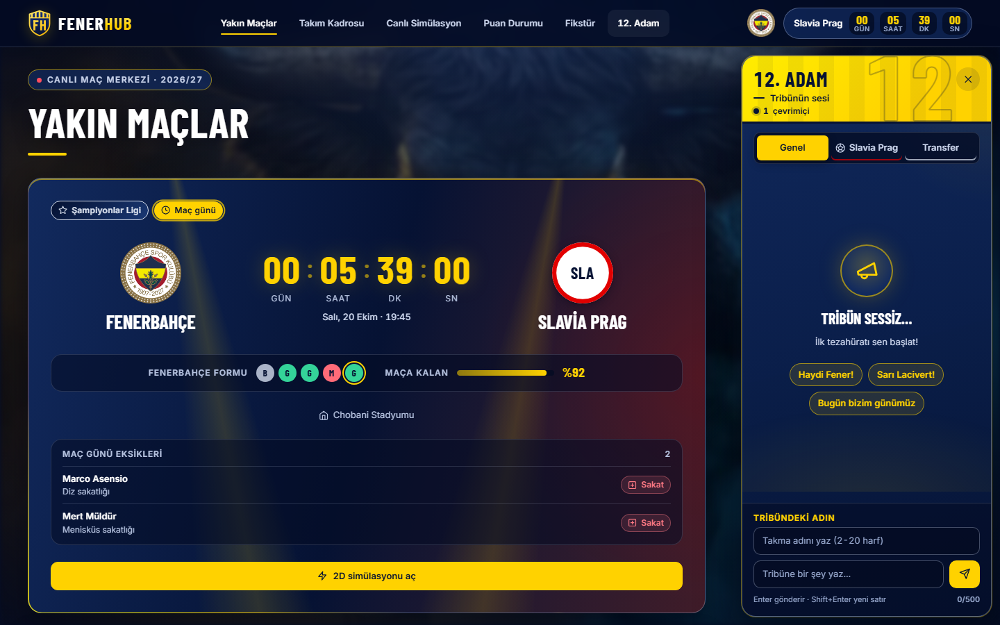
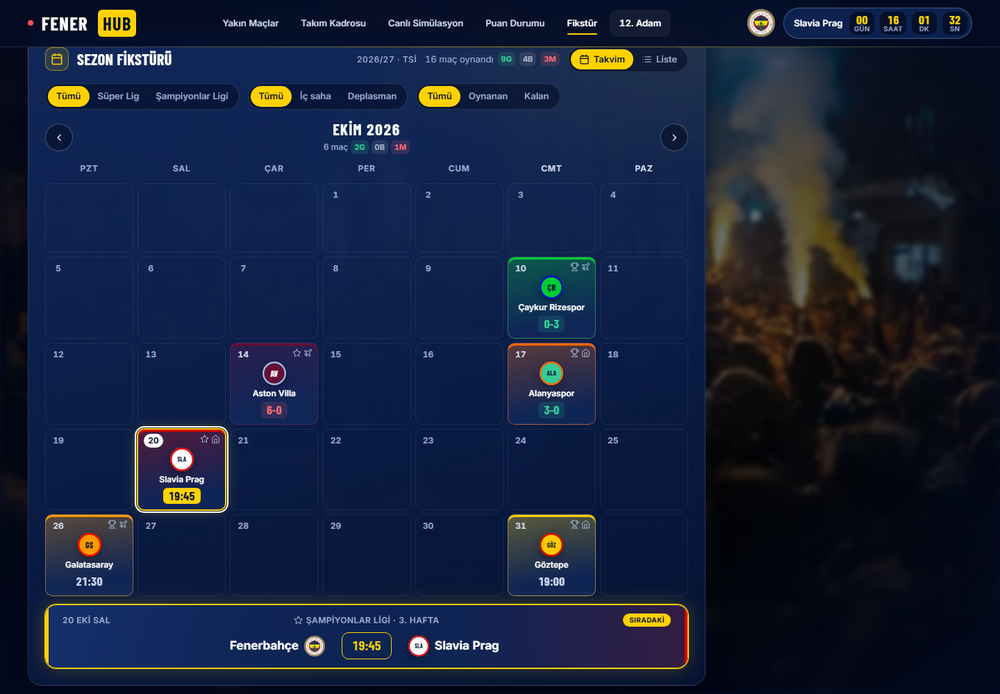
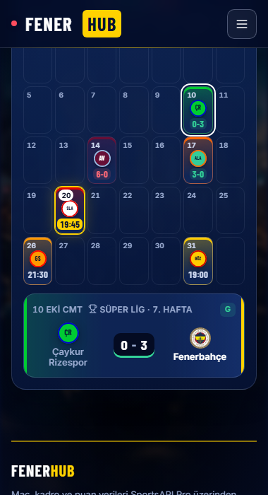
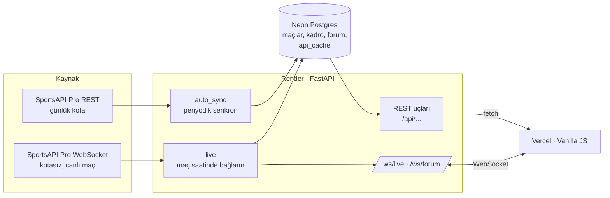

# FenerHub

Fenerbahçe taraftarları için maç merkezi: yakın maçlar ve geri sayım, kadro istatistikleri, puan durumu, sezon fikstürü, 2D maç simülasyonu ve canlı taraftar sohbeti.

**Canlı demo:** https://fenerhub-frontend.vercel.app
**API:** https://fenerhub.onrender.com (örnek: [`/api/matches/upcoming`](https://fenerhub.onrender.com/api/matches/upcoming), etkileşimli dokümantasyon: [`/docs`](https://fenerhub.onrender.com/docs))

> API ücretsiz Render planında çalışır; bir süre istek gelmezse uyur. İlk açılış 30–60 saniye sürebilir.



| Fikstür (takvim görünümü) | Mobil |
|---|---|
|  |  |

## Özellikler

- **Yakın maçlar:** sıradaki üç maç, canlı geri sayım, Fenerbahçe formu, maç günü eksikleri. Kartlar rakibin kulüp renklerine bürünür.
- **Kadro:** mevkiye göre filtre, sıralanabilir maç / gol / asist istatistikleri, sakatlık ve ceza raporu.
- **Puan durumu:** Süper Lig ve Şampiyonlar Ligi tabloları, bölge renkleri (şampiyonluk, Avrupa, düşme).
- **Fikstür:** aylık takvim ya da liste görünümü; turnuva, iç saha / deplasman ve oynanan / kalan filtreleri.
- **2D simülasyon:** canvas üzerinde diziliş ve top akışı; maç oynanırken gerçek olaylara tepki verir.
- **12. Adam:** WebSocket ile canlı taraftar sohbeti; genel, transfer ve maç odaları, yanıt, tepki, kendi mesajını silme.
- **Canlı maç (geliştiriliyor):** backend maç saatinde SportsAPI WebSocket'ine bağlanır, skoru ve olayları kendi `/ws/live` kanalından tarayıcılara aktarır. API anahtarı tarayıcıya hiç gitmez.

## Teknolojiler

| Katman | Kullanılanlar |
|---|---|
| Backend | Python, FastAPI, SQLAlchemy 2, Alembic, WebSocket (`websockets`), pytest |
| Veritabanı | PostgreSQL (Neon), yerelde SQLite |
| Frontend | Vanilla JavaScript, HTML, CSS (container queries, `:has()`, View Transitions, Popover API), GSAP, Canvas |
| Veri | SportsAPI Pro (REST + WebSocket) |
| Barındırma | Render (API), Vercel (statik site) |

## Mimari



- **Kota yönetimi:** SportsAPI'nin ücretsiz planı günde 100 istek verir. Her cevap veritabanındaki `api_cache` tablosunda saklanır; sunucu uyuyup uyandığında aynı veri tekrar çekilmez. Canlı maç WebSocket'ten geldiği için maç sırasında REST isteği atılmaz.
- **Şema:** Alembic migration'ları uygulama açılırken çalışır (Render'ın ücretsiz planında komut satırı olmadığı için).
- **Gerçek kullanıcı IP'si:** Render ve Cloudflare proxy'lerinin arkasında `X-Forwarded-For` sağdan okunur; forumdaki hız sınırı kullanıcı başına çalışır.

## Kurulum (yerel)

Gerekenler: Python 3.12+, bir SportsAPI Pro anahtarı (ücretsiz plan yeterli).

```bash
cd backend
python -m venv venv
venv\Scripts\activate            # macOS/Linux: source venv/bin/activate
pip install -r requirements-dev.txt

copy .env.example .env           # macOS/Linux: cp .env.example .env
# .env içine SPORTS_API_KEY yazın; DATABASE_URL boş kalırsa yerel SQLite kullanılır

uvicorn app.main:app --reload --port 8000
```

Frontend'i ayrı bir terminalde statik olarak sunun (site `localhost`'ta açılınca API olarak otomatik `http://127.0.0.1:8000` kullanır):

```bash
cd frontend
python -m http.server 5500
# http://localhost:5500
```

Testler: `cd backend && python -m pytest` (backend), `node --test "frontend/tests/*.test.cjs"` (frontend, kök klasörde; ek paket gerekmez)

### Elle çalıştırılan araçlar (backend klasöründe)

| Komut | Ne yapar |
|---|---|
| `python -m app.sync` | Maçları, kadroyu, istatistikleri ve puan durumunu API'den çeker (`--offline`: sadece önbellek, istek atmaz) |
| `python -m scripts.add_absence liste` | Sakatlık / ceza kayıtlarını listeler; `ekle` ve `sil` alt komutları da var |
| `python -m scripts.download_logos --dry-run` | Eksik takım logolarını sayar; parametresiz çalışınca indirir (her logo 1 istek) |
| `python -m scripts.migrate_to_postgres --dry-run` | Yerel SQLite verisini Postgres'e aktarır (tek seferlik) |
| `python -m scripts.seed` | **Veritabanını siler** ve eski örnek verileri yükler; onay ister, canlıda kullanılmaz |

## API uç noktaları

| Yöntem | Yol | Açıklama |
|---|---|---|
| GET | `/api/health` | Sağlık kontrolü |
| GET | `/api/matches` | Sezonun bütün maçları (`?competition=super_lig\|uefa`) |
| GET | `/api/matches/upcoming` | Sıradaki maçlar ve maç günü eksikleri |
| GET | `/api/matches/{id}` | Tek maç |
| GET | `/api/matches/{id}/detail` | Olaylar, istatistikler, kadrolar (önbellekten) |
| GET | `/api/squad` | Kadro ve sezon istatistikleri |
| GET | `/api/absences` | Sakatlık ve ceza raporu |
| GET | `/api/standings/{super_lig\|uefa}` | Puan durumu |
| GET | `/api/live` | Canlı maç durumu (WebSocket açamayan istemciler için) |
| WS | `/ws/live` | Canlı skor, olaylar, gol bildirimi |
| GET | `/api/forum/posts?room=genel` | Oda mesajları |
| POST | `/api/forum/posts` | Mesaj gönder |
| POST | `/api/forum/posts/{id}/react` | Tepki (🔥 / ❤️) |
| POST | `/api/forum/posts/{id}/delete` | Kendi mesajını sil |
| GET | `/api/forum/next-match` | Açık maç odası |
| WS | `/ws/forum` | Yeni mesaj, tepki ve çevrimiçi sayısı |

## Klasör yapısı

```
FenerHub/
├── backend/
│   ├── app/                 FastAPI uygulaması
│   │   ├── main.py          uygulama, CORS, açılış işleri
│   │   ├── database.py      bağlantı (Postgres ya da SQLite)
│   │   ├── models.py        SQLAlchemy modelleri
│   │   ├── sync.py          SportsAPI -> veritabanı
│   │   ├── auto_sync.py     periyodik senkron
│   │   ├── live.py          canlı maç WebSocket istemcisi, /ws/live
│   │   ├── cache.py         API önbelleği (api_cache tablosu)
│   │   ├── forum.py         12. Adam sohbeti
│   │   ├── net.py           proxy arkasında gerçek istemci IP'si
│   │   ├── migrate.py       açılışta Alembic migration'ları
│   │   └── routers/         matches, squad, standings, absences
│   ├── migrations/          Alembic sürümleri
│   ├── scripts/             elle çalıştırılan araçlar
│   ├── tests/               pytest
│   ├── alembic.ini
│   ├── requirements.txt
│   └── .env.example
├── frontend/
│   ├── index.html
│   ├── css/style.css
│   ├── js/                  api, forum, matchEngine (2D simülasyon), fx, nav, background
│   ├── img/                 logolar
│   └── frames/              kaydırmaya bağlı arka plan animasyonu kareleri
├── tools/extract.py         videolardan arka plan karesi çıkarma (geliştirme aracı)
├── docs/                    yol haritası ve ekran görüntüleri
├── LICENSE
└── README.md
```

## Yol haritası

Planlanan ve tamamlanan aşamalar: [docs/ROADMAP.md](docs/ROADMAP.md)

## Not

Bu site Fenerbahçe SK ile resmi bir bağlantısı olmayan bir taraftar projesidir. Kulüp adı ve logosu ilgili hak sahiplerine aittir. Maç verileri SportsAPI Pro'dan alınır.

## Lisans

[MIT](LICENSE)

---

## English summary

**FenerHub** is a fan-made match center for Fenerbahçe: upcoming fixtures with countdowns, squad statistics, league tables, a monthly fixture calendar, a 2D canvas match simulation and a real-time fan chat over WebSockets.

- **Backend:** FastAPI, SQLAlchemy, Alembic, PostgreSQL (Neon), deployed on Render. A background sync pulls data from SportsAPI Pro within a 100-requests/day free quota by caching every response in the database. During a match the backend connects to SportsAPI's WebSocket (quota-free) and relays live scores to browsers through its own `/ws/live` channel, so the API key never reaches the client.
- **Frontend:** framework-free JavaScript, modern CSS (container queries, `:has()`, View Transitions, Popover API), GSAP and Canvas, deployed on Vercel.
- **Run locally:** see *Kurulum* above (`uvicorn app.main:app` in `backend/`, any static server in `frontend/`).

This is an unofficial fan project with no affiliation to Fenerbahçe SK.
