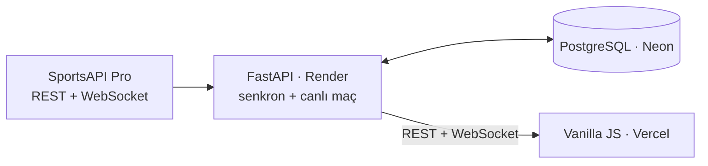

# FenerHub


[](LICENSE)

Fenerbahçe taraftarları için canlı maç merkezi: canlı skor ve 2D maç simülasyonu, maç özeti, skor tahmin oyunu,
kadro istatistikleri, puan durumu, sezon fikstürü ve taraftar sohbeti. Telefona uygulama gibi kurulur, gol bildirimi gönderir.

**[Canlı site](https://fenerhub.vercel.app)** · **[Maç demosu ▶](https://fenerhub.vercel.app/?demo=live)** · **[API dokümanı](https://fenerhub.onrender.com/docs)** · **[Teknik kararlar](docs/teknik-kararlar.md)**


| Simülasyon ve canlı anlatım | Sezon fikstürü | Mobil |
|---|---|---|
|  |  |  |

| Maç özeti (şut haritası, xG) | Skor tahmin oyunu |
|---|---|
|  |  |

## Öne çıkanlar

- **Canlı veri, ücretsiz kotayla:** Günde 100 isteklik plana bütçe kuralı, veritabanında önbellek ve uyarlanan sorgu aralıklarıyla sığıyor.
- **WebSocket proxy:** Maç saatinde backend tek bağlantıyla canlı veriyi alır ve tüm izleyicilere yayar. API anahtarı tarayıcıya gitmez.
- **Gerçek olaylarla simülasyon:** Goller, kartlar, değişiklikler ve VAR sahada canlanır; şablonlu bir spiker her olayı anlatır. Maç bitince şut haritası (xG), baskı grafiği ve en iyi oyuncularla özet. [Demo](https://fenerhub.vercel.app/?demo=live): 20 Ekim Fenerbahçe – Slavia Prag maçının gerçek canlı kaydı, hızlandırılmış.
- **Taraftarlar vs istatistik modeli:** Hesapsız skor tahmin oyunu ve liderlik tablosu; rakip olarak puan durumundaki gollerden Poisson modeliyle tahmin yapan bir model. Maç bitince "maçın oyuncusu" oylaması.
- **Uygulama gibi:** PWA (kurulum, çevrimdışı sayfa), Web Push ile gol ve maç başladı bildirimi, fikstür için takvim aboneliği (`.ics`).
- **Güvenli forum:** Türkçe harf oyunlarını yakalayan küfür filtresi, IP başına hız sınırı, 3 farklı bildirimle mesaj gizleme.
- **Veri kaybı olmadan altyapı:** SQLite'tan PostgreSQL'e geçiş, komut satırı olmayan sunucuda açılışta çalışan migration'lar.
- **Testli:** 106 backend (pytest) ve 13 frontend (`node --test`) testi; testler ağa çıkamaz, kota harcamaz. GitHub Actions iş akışı hazır.

## Teknolojiler

**Backend:** Python, FastAPI, SQLAlchemy, Alembic, WebSocket · **Veritabanı:** PostgreSQL (Neon) ·
**Frontend:** Vanilla JavaScript, CSS, Canvas · **Altyapı:** Render, Vercel, GitHub Actions · **Veri:** SportsAPI Pro



## Çalıştırma

```bash
cd backend
pip install -r requirements-dev.txt
cp .env.example .env               # SPORTS_API_KEY'i yazın
uvicorn app.main:app --reload      # frontend: frontend/ klasörünü statik sunun
```

Ayrıntılar (testler, araçlar, ortam değişkenleri, API, klasör yapısı): **[docs/gelistirme.md](docs/gelistirme.md)** ·
Yol haritası: **[docs/ROADMAP.md](docs/ROADMAP.md)**

---

**English:** FenerHub is a fan-made live match center for Fenerbahçe built with FastAPI, PostgreSQL and vanilla
JavaScript. It fits a 100-requests/day API plan through budgeting and caching, relays live match events to all
viewers over its own WebSocket channel, and animates real goals, cards and substitutions in a 2D simulation.
It also has a score prediction game against a Poisson model, post-match shot maps, push notifications for goals
and an installable PWA.

Bu site Fenerbahçe SK ile resmi bir bağlantısı olmayan bir taraftar projesidir. Veriler SportsAPI Pro'dan alınmaktadır. · [MIT Lisansı](LICENSE)
