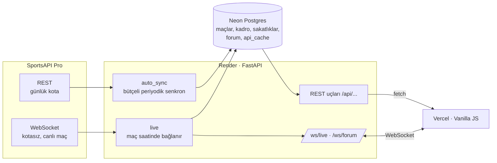

# FenerHub

[](https://github.com/kutluktaskin/FenerHub/actions/workflows/ci.yml)


[](LICENSE)

Fenerbahçe taraftarları için canlı maç merkezi: maç kartları ve geri sayım, canlı skor ve olayları gösteren
2D maç simülasyonu, kadro istatistikleri, puan durumu, sezon fikstürü ve WebSocket ile çalışan taraftar sohbeti.

**🔗 Canlı demo:** https://fenerhub-frontend.vercel.app
**🔗 API:** https://fenerhub.onrender.com/docs (etkileşimli dokümantasyon)

> API ücretsiz Render planında çalışır; bir süre istek gelmezse uyur, ilk açılış 30–60 saniye sürebilir.


| 2D maç simülasyonu ve canlı anlatım | Sezon fikstürü | Mobil |
|---|---|---|
|  |  |  |

## Mühendislik açısından öne çıkanlar

- **Günde 100 istekle canlı site:** SportsAPI'nin ücretsiz planına sığmak için bütçe kuralı (%60), veritabanında kalıcı API önbelleği ve işe göre değişen sorgu aralıkları. Bir maçın maliyeti ~60 istekten birkaç isteğe indi.
- **WebSocket proxy:** Backend maç saatinde SportsAPI WebSocket'ine tek bağlantı kurar ve olayları kendi `/ws/live` kanalıyla bütün izleyicilere yayar. API anahtarı tarayıcıya gitmez. Kopmada artan beklemeyle yeniden bağlanır, uzun kesintide kotaya duyarlı REST yedeğine geçer.
- **Shell olmadan migration:** Render'ın ücretsiz planında komut satırı olmadığı için Alembic migration'ları uygulama açılırken çalışır. Alembic öncesi veritabanı veriye dokunmadan işaretlenir.
- **SQLite → PostgreSQL geçişi:** Veri kaybı olmadan, id'leri ve canlı forum mesajlarını koruyan tek seferlik aktarım.
- **Proxy arkasında gerçek IP:** `X-Forwarded-For` sağdan okunur, Cloudflare ve özel ağlar atlanır; forumdaki hız sınırı sahteleme yapılamadan kullanıcı başına çalışır.
- **Otomatik sakatlık raporu:** Kadro verisindeki eksik oyuncu listesi Türkçeye çevrilip rapora işlenir. Elle girilen kayıtlar korunur.
- **Test ve CI:** 33 backend (pytest) ve 7 frontend (`node --test`) testi her push'ta GitHub Actions'ta çalışır.

Kararların gerekçeleri ve bedelleri: **[docs/teknik-kararlar.md](docs/teknik-kararlar.md)**

## Özellikler

- **Yakın maçlar:** sıradaki üç maç, canlı geri sayım, Fenerbahçe formu, maç günü eksikleri. Kartlar rakibin kulüp renklerine bürünür.
- **2D maç simülasyonu:** gerçek kadro (forma numarası, isim), canlı skor ve dakika. Gol, kart, oyuncu değişikliği, VAR ve penaltı sahada canlandırılır; şablonlu spiker cümleleri ve anlatım akışı. Skor, olaylar ve kadro gerçek; oyuncu konumları temsili.
- **Kadro:** mevkiye göre filtre, sıralanabilir maç / gol / asist istatistikleri, otomatik güncellenen sakatlık ve ceza raporu.
- **Puan durumu:** Süper Lig ve Şampiyonlar Ligi, bölge renkleri (şampiyonluk, Avrupa, düşme).
- **Sezon fikstürü:** bütün maçlar yan yana takvim yapraklarında (tarih, iç saha / deplasman, skor ya da saat) ya da liste görünümünde; turnuva, saha ve oynanan / kalan filtreleri.
- **12. Adam:** WebSocket ile canlı taraftar sohbeti. Genel, transfer ve maç odaları; yanıt, tepki, kendi mesajını silme.

## Teknolojiler

| Katman | Kullanılanlar |
|---|---|
| Backend | Python 3.13, FastAPI, SQLAlchemy 2, Alembic, `websockets`, pytest |
| Veritabanı | PostgreSQL (Neon), yerelde SQLite |
| Frontend | Vanilla JavaScript, HTML, CSS (container queries, `:has()`, View Transitions, Popover API), Canvas, GSAP |
| Veri | SportsAPI Pro (REST + WebSocket) |
| Altyapı | Render (API), Vercel (statik site), GitHub Actions (CI) |

## Mimari



## Yerelde çalıştırma

Gerekenler: Python 3.12+, Node 18+ (sadece frontend testleri için), bir SportsAPI Pro anahtarı (ücretsiz plan yeterli).

```bash
cd backend
python -m venv venv
venv\Scripts\activate              # macOS/Linux: source venv/bin/activate
pip install -r requirements-dev.txt

copy .env.example .env             # macOS/Linux: cp .env.example .env
# .env içine SPORTS_API_KEY yazın; DATABASE_URL boş kalırsa yerel SQLite kullanılır

uvicorn app.main:app --reload --port 8000
```

Frontend'i ayrı bir terminalde statik olarak sunun. Site `localhost`'ta açılınca API olarak otomatik `http://127.0.0.1:8000` kullanır:

```bash
cd frontend
python -m http.server 5500         # http://localhost:5500
```

### Testler

```bash
cd backend && python -m pytest                # backend
node --test "frontend/tests/*.test.cjs"       # frontend (kök klasörde, ek paket gerekmez)
```

### Elle çalıştırılan araçlar (backend klasöründe)

| Komut | Ne yapar |
|---|---|
| `python -m app.sync` | Maçları, kadroyu, istatistikleri ve puan durumunu API'den çeker (`--offline`: sadece önbellek, istek atmaz) |
| `python -m scripts.add_absence liste` | Sakatlık ve ceza kayıtlarını listeler; `ekle` ve `sil` alt komutları da var |
| `python -m scripts.download_logos --dry-run` | Eksik takım logolarını sayar; parametresiz çalışınca indirir (her logo 1 istek) |
| `python -m scripts.migrate_to_postgres --dry-run` | Yerel SQLite verisini Postgres'e aktarır (tek seferlik) |
| `python -m scripts.seed` | **Veritabanını siler** ve eski örnek verileri yükler; onay ister, canlıda kullanılmaz |

### Ortam değişkenleri

| Değişken | Açıklama |
|---|---|
| `SPORTS_API_KEY` | SportsAPI Pro anahtarı. Sadece backend'de; tarayıcıya gitmez. |
| `DATABASE_URL` | Postgres adresi (Neon pooled). Boşsa yerel SQLite. |
| `RENDER` | Render'ın kendisi tanımlar; Render'da SQLite'a düşülürse log'a uyarı yazdırır. |

## API uç noktaları

| Yöntem | Yol | Açıklama |
|---|---|---|
| GET | `/api/health` | Sağlık kontrolü |
| GET | `/api/matches` | Sezonun bütün maçları (`?competition=super_lig\|uefa`) |
| GET | `/api/matches/upcoming` | Sıradaki maçlar ve maç günü eksikleri |
| GET | `/api/matches/{id}` | Tek maç |
| GET | `/api/matches/{id}/detail` | Olaylar, istatistikler, kadrolar (önbellekten, istek atmaz) |
| GET | `/api/squad` | Kadro ve sezon istatistikleri |
| GET | `/api/absences` | Sakatlık ve ceza raporu (`source`: `api` / `manual`) |
| GET | `/api/standings/{super_lig\|uefa}` | Puan durumu |
| GET | `/api/live` | Canlı maç durumu (WebSocket açamayan istemciler için) |
| WS | `/ws/live` | Canlı skor, olaylar, gol bildirimi |
| GET | `/api/forum/posts?room=genel` | Oda mesajları |
| POST | `/api/forum/posts` | Mesaj gönder (IP başına 4 sn sınır) |
| POST | `/api/forum/posts/{id}/react` | Tepki (🔥 / ❤️) |
| POST | `/api/forum/posts/{id}/delete` | Kendi mesajını sil |
| GET | `/api/forum/next-match` | Açık maç odası |
| WS | `/ws/forum` | Yeni mesaj, tepki ve çevrimiçi sayısı |

## Klasör yapısı

```
FenerHub/
├── backend/
│   ├── app/
│   │   ├── main.py            uygulama, CORS, açılışta migration ve arka plan işleri
│   │   ├── database.py        bağlantı (Postgres ya da SQLite)
│   │   ├── models.py          SQLAlchemy modelleri
│   │   ├── sync.py            SportsAPI -> veritabanı
│   │   ├── auto_sync.py       bütçeli periyodik senkron
│   │   ├── live.py            canlı maç WebSocket istemcisi ve /ws/live
│   │   ├── absences_sync.py   eksik oyuncu listesinden otomatik sakatlık raporu
│   │   ├── cache.py           API önbelleği (api_cache tablosu)
│   │   ├── forum.py           12. Adam sohbeti
│   │   ├── net.py             proxy arkasında gerçek istemci IP'si
│   │   ├── migrate.py         açılışta Alembic migration'ları
│   │   └── routers/           matches, squad, standings, absences
│   ├── migrations/            Alembic sürümleri (0001–0004)
│   ├── scripts/               elle çalıştırılan araçlar
│   ├── tests/                 pytest
│   └── requirements.txt       sabit sürümler
├── frontend/
│   ├── index.html
│   ├── css/style.css
│   ├── js/                    api, matchEngine (simülasyon), commentary (anlatıcı), forum, fx, nav
│   ├── tests/                 node --test
│   ├── img/                   logolar ve favicon
│   └── frames/                kaydırmaya bağlı arka plan animasyonu kareleri
├── tools/extract.py           videolardan arka plan karesi çıkarma (geliştirme aracı)
├── docs/                      teknik kararlar, yol haritası, ekran görüntüleri
└── .github/workflows/ci.yml   GitHub Actions
```

## Yol haritası

Tamamlanan ve planlanan aşamalar: [docs/ROADMAP.md](docs/ROADMAP.md). Sıradakiler: maç sonu özeti ve maç tekrarı, skor tahmin oyunu, istatistik modeliyle tahmin rakibi, PWA.

## Not

Bu site Fenerbahçe SK ile resmi bir bağlantısı olmayan bir taraftar projesidir. Kulüp adı ve logosu ilgili hak sahiplerine aittir. Maç verileri SportsAPI Pro'dan alınır.

## Lisans

[MIT](LICENSE)

---

## English summary

**FenerHub** is a fan-made live match center for Fenerbahçe: match cards with countdowns, a 2D canvas match simulation driven by live events, squad statistics, league tables, a season fixture strip and a real-time fan chat over WebSockets.

- **Backend:** FastAPI, SQLAlchemy, Alembic, PostgreSQL (Neon), deployed on Render. Fits a 100-requests/day free API plan with a request budget, a database-backed response cache and adaptive polling. During a match it opens a single quota-free WebSocket to the data provider and fans the events out to all browsers through its own `/ws/live` channel, so the API key never reaches the client. Migrations run at startup because the free host has no shell.
- **Frontend:** framework-free JavaScript and modern CSS on Vercel. The simulation animates real goals, cards, substitutions and VAR decisions; a template-based commentator writes Turkish play-by-play lines from the real event data.
- **Quality:** 33 backend and 7 frontend tests on every push via GitHub Actions. Design decisions and trade-offs: [docs/teknik-kararlar.md](docs/teknik-kararlar.md) (Turkish).

This is an unofficial fan project with no affiliation to Fenerbahçe SK.
