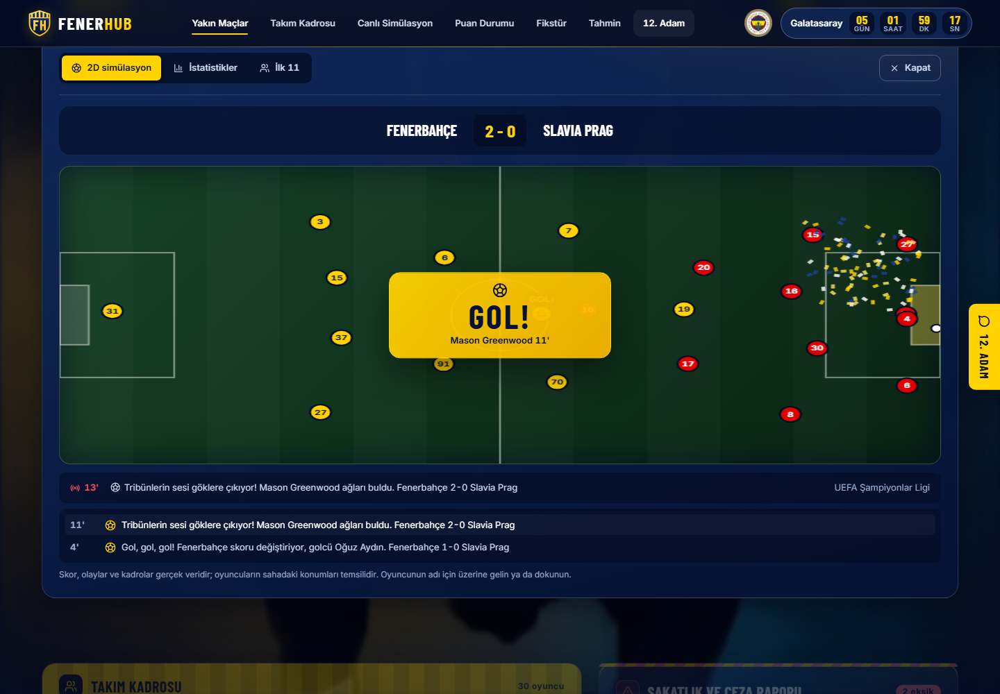
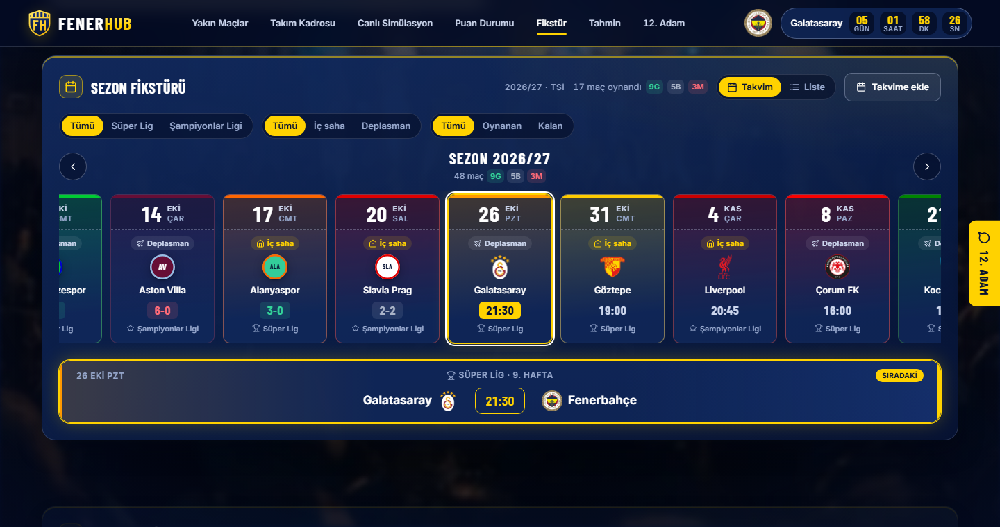
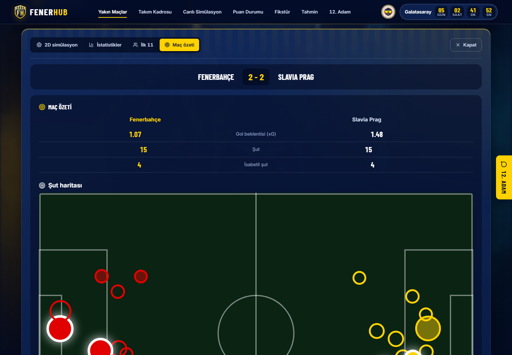
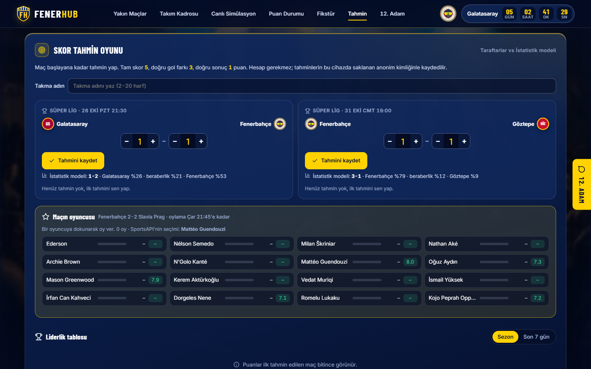
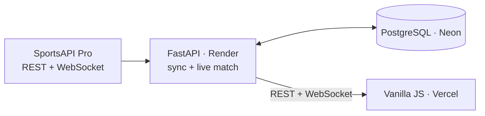

# FenerHub


[](LICENSE)

**English** · [Türkçe](#türkçe)

A fan-made live match center for Fenerbahçe: live scores with a 2D match simulation, post-match summaries,
a score prediction game, squad stats, standings, the season fixture list and a fan chat. Installable as an app
and sends goal notifications.

**[Live site](https://fenerhub.vercel.app)** · **[Match demo ▶](https://fenerhub.vercel.app/?demo=live)** · **[API docs](https://fenerhub.onrender.com/docs)** · **[Technical decisions (TR)](docs/teknik-kararlar.md)**


| Simulation and live commentary | Season fixtures | Mobile |
|---|---|---|
|  |  |  |

| Match summary (shot map, xG) | Score prediction game |
|---|---|
|  |  |

## Highlights

- **Live data on a free plan:** Fits a 100-requests/day API plan through a request budget, a database-backed cache and adaptive polling.
- **WebSocket proxy:** During a match the backend holds a single upstream connection and relays events to every viewer. The API key never reaches the browser.
- **Simulation driven by real events:** Goals, cards, substitutions and VAR play out on the pitch with template-based commentary. After the final whistle: shot map (xG), momentum graph and top players. The [demo](https://fenerhub.vercel.app/?demo=live) replays the real live recording of Fenerbahçe – Slavia Prague (20 Oct), sped up.
- **Fans vs a statistical model:** Account-free score predictions with a leaderboard, competing against a Poisson model built from league goal data. "Player of the match" voting after each game.
- **App-like:** PWA (install, offline page), Web Push notifications for kickoff and goals, calendar subscription (`.ics`) for fixtures.
- **Safe forum:** Profanity filter that catches Turkish character tricks, per-IP rate limits, posts hidden after 3 distinct reports.
- **Zero-data-loss infrastructure:** Migrated from SQLite to PostgreSQL; migrations run on startup on a host without shell access.
- **Tested:** 106 backend (pytest) and 13 frontend (`node --test`) tests; tests cannot reach the network and never spend API quota.

## Tech stack

**Backend:** Python, FastAPI, SQLAlchemy, Alembic, WebSocket · **Database:** PostgreSQL (Neon) ·
**Frontend:** Vanilla JavaScript, CSS, Canvas · **Hosting:** Render, Vercel, GitHub Actions · **Data:** SportsAPI Pro



## Getting started

```bash
cd backend
pip install -r requirements-dev.txt
cp .env.example .env               # add SPORTS_API_KEY
uvicorn app.main:app --reload      # frontend: serve the frontend/ folder statically
```

More (tests, tools, environment variables, API, folder layout, in Turkish): **[docs/gelistirme.md](docs/gelistirme.md)** ·
Roadmap: **[docs/ROADMAP.md](docs/ROADMAP.md)**

---

## Türkçe

Fenerbahçe taraftarları için canlı maç merkezi: canlı skor ve 2D maç simülasyonu, maç özeti, skor tahmin oyunu,
kadro istatistikleri, puan durumu, sezon fikstürü ve taraftar sohbeti. Telefona uygulama gibi kurulur, gol bildirimi gönderir.

**[Canlı site](https://fenerhub.vercel.app)** · **[Maç demosu ▶](https://fenerhub.vercel.app/?demo=live)** · **[API dokümanı](https://fenerhub.onrender.com/docs)** · **[Teknik kararlar](docs/teknik-kararlar.md)**

### Öne çıkanlar

- **Canlı veri, ücretsiz kotayla:** Günde 100 isteklik plana bütçe kuralı, veritabanında önbellek ve uyarlanan sorgu aralıklarıyla sığıyor.
- **WebSocket proxy:** Maç saatinde backend tek bağlantıyla canlı veriyi alır ve tüm izleyicilere yayar. API anahtarı tarayıcıya gitmez.
- **Gerçek olaylarla simülasyon:** Goller, kartlar, değişiklikler ve VAR sahada canlanır; şablonlu bir spiker her olayı anlatır. Maç bitince şut haritası (xG), baskı grafiği ve en iyi oyuncularla özet. [Demo](https://fenerhub.vercel.app/?demo=live): 20 Ekim Fenerbahçe – Slavia Prag maçının gerçek canlı kaydı, hızlandırılmış.
- **Taraftarlar vs istatistik modeli:** Hesapsız skor tahmin oyunu ve liderlik tablosu; rakip olarak puan durumundaki gollerden Poisson modeliyle tahmin yapan bir model. Maç bitince "maçın oyuncusu" oylaması.
- **Uygulama gibi:** PWA (kurulum, çevrimdışı sayfa), Web Push ile gol ve maç başladı bildirimi, fikstür için takvim aboneliği (`.ics`).
- **Güvenli forum:** Türkçe harf oyunlarını yakalayan küfür filtresi, IP başına hız sınırı, 3 farklı bildirimle mesaj gizleme.
- **Veri kaybı olmadan altyapı:** SQLite'tan PostgreSQL'e geçiş, komut satırı olmayan sunucuda açılışta çalışan migration'lar.
- **Testli:** 106 backend (pytest) ve 13 frontend (`node --test`) testi; testler ağa çıkamaz, kota harcamaz.

### Teknolojiler

**Backend:** Python, FastAPI, SQLAlchemy, Alembic, WebSocket · **Veritabanı:** PostgreSQL (Neon) ·
**Frontend:** Vanilla JavaScript, CSS, Canvas · **Altyapı:** Render, Vercel, GitHub Actions · **Veri:** SportsAPI Pro

### Çalıştırma

```bash
cd backend
pip install -r requirements-dev.txt
cp .env.example .env               # SPORTS_API_KEY'i yazın
uvicorn app.main:app --reload      # frontend: frontend/ klasörünü statik sunun
```

Ayrıntılar (testler, araçlar, ortam değişkenleri, API, klasör yapısı): **[docs/gelistirme.md](docs/gelistirme.md)** ·
Yol haritası: **[docs/ROADMAP.md](docs/ROADMAP.md)**

---

This is an unofficial fan project with no affiliation to Fenerbahçe SK. Data is provided by SportsAPI Pro.<br>
Bu site Fenerbahçe SK ile resmi bir bağlantısı olmayan bir taraftar projesidir. Veriler SportsAPI Pro'dan alınmaktadır.<br>
[MIT License](LICENSE)
